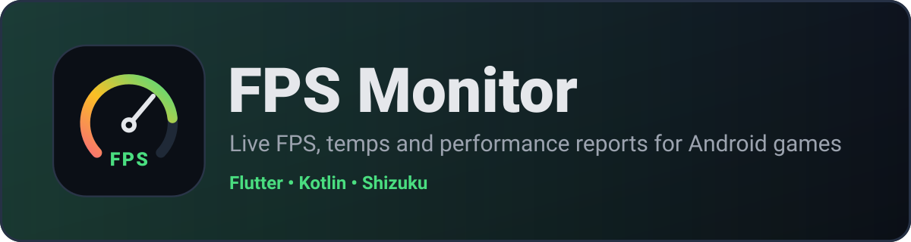

<div align="center">



<br/>

[](https://flutter.dev)
[](https://kotlinlang.org)
[-3DDC84?logo=android&logoColor=white)](https://developer.android.com)
[](https://shizuku.rikka.app)
[](https://github.com/zsdev07/ZFps/actions/workflows/flutter-ci.yml)
[](LICENSE)
[](CONTRIBUTING.md)
[](pubspec.yaml)

**Live FPS, CPU/GPU temperature, RAM and per-session performance reports for Android games, in a draggable floating overlay.**

[Features](#-features) •
[Screenshots](#-screenshots) •
[Getting started](#-getting-started) •
[Customization](#-overlay-customization) •
[How it works](#-how-it-works) •
[Build](#-build-from-source) •
[Contributing](#-contributing)

</div>

---

## ✨ Features

| | |
|---|---|
| 🎮 **Floating overlay** | Live FPS drawn on top of any game. **Drag it anywhere**; the position is remembered. |
| 🎨 **Fully customizable** | Choose what to show, background transparency and text size, with a live preview and presets. |
| 🌡️ **Temperatures** | CPU and GPU temperature from kernel thermal zones, with the Android thermal service as a fallback. |
| 📊 **System stats** | CPU usage, GPU usage (Qualcomm, MediaTek, Mali and more), free RAM and storage speed. |
| 🧾 **Session reports** | Every session is saved: avg/max FPS, avg temperatures, CPU/GPU usage, free RAM, battery drop and duration. |
| 🔔 **Foreground service** | Monitoring keeps running while the game is in the foreground. |
| 🌙 **Dark Material 3 UI** | Clean dark theme, portrait only, lightweight local storage (Hive), no accounts, no ads, no tracking. |

**FPS colors:** green at 55 and above (60 / 90 / 120 fps), yellow from 30 to 54, red below 30.

## 📸 Screenshots

> Add your screenshots to [`docs/screenshots/`](docs/screenshots) using the file names below.

| Home | Customize | Overlay | Reports |
|:---:|:---:|:---:|:---:|
|  |  |  |  |

## 🚀 Getting started

### Requirements

- Android **7.0+** (API 24)
- [**Shizuku**](https://shizuku.rikka.app) installed and running, which gives the app read access to system stats such as temperatures, CPU usage and SurfaceFlinger frame timing
- **Display over other apps** permission for the floating overlay

> Without Shizuku the app still opens, but most hardware readings are unavailable.

### Install

1. Download the latest APK from the [Releases](https://github.com/zsdev07/ZFps/releases) page, or [build it yourself](#-build-from-source).
2. Install [Shizuku](https://shizuku.rikka.app) and start it:
   - **Android 11+:** use *Wireless debugging* (Settings → Developer options), then start Shizuku from its app.
   - **Via ADB** (any supported device):
     ```sh
     adb shell sh /storage/emulated/0/Android/data/moe.shizuku.privileged.api/start.sh
     ```
   - **Rooted devices:** start Shizuku in root mode.
3. Open **FPS Monitor** and tap **Connect Shizuku**, then accept the permission dialog.
4. Grant **Display over other apps**.
5. Pick a game, start monitoring, and launch the game. 🎮

## 🎛️ Overlay customization

Open **Customize overlay** from the home screen (tune icon in the top bar, or the card under the overlay permission).

- **Presets:** *Minimal* (a transparent, big colored FPS number only), *FPS + RAM*, *Standard*, *Everything*
- **Toggles:** FPS, "FPS" label, CPU temp, GPU temp, free RAM, CPU usage, GPU usage
- **Appearance:** background opacity (0% = fully transparent) and text size
- Changes apply **instantly** to a running overlay and are saved
- Transparent bars get a soft text shadow so they stay readable on bright scenes

## ⚙️ How it works

```
┌──────────────────────── Flutter (Dart) ────────────────────────┐
│  Home · Customize · Reports   →   MonitorService (2 s polling)  │
│          Hive (sessions)          ShizukuService / OverlayService│
└───────────────────────────┬─────────────────────────────────────┘
                            │ MethodChannel  com.zsdev.fpsmonitor/channel
┌───────────────────────────▼─────────────────────────────────────┐
│ Kotlin: PlatformChannelHandler                                   │
│   ShizukuClient ──► UserService (shell uid, via AIDL)            │
│   SystemMetrics   FPS · temps · RAM · CPU/GPU usage · storage    │
│   MonitorService  foreground service + wake lock                 │
│   OverlayService  draggable WindowManager overlay + OverlayConfig│
└──────────────────────────────────────────────────────────────────┘
```

| Metric | Source |
|---|---|
| **FPS** | `dumpsys SurfaceFlinger --latency` frame timestamps for the game's layer, clamped to the display refresh rate. Falls back to the refresh rate if the layer can't be found. |
| **Temperature** | `/sys/class/thermal`, hwmon and Adreno sensors, then `dumpsys thermalservice`, then skin/battery as a last resort. |
| **CPU usage** | Delta between two `/proc/stat` samples. |
| **GPU usage** | Qualcomm `kgsl`, MediaTek `ged`, Mali and generic devfreq nodes; estimated from GPU clock if no load counter exists. |
| **Free RAM** | `MemAvailable` from `/proc/meminfo`. |
| **Storage speed** | Short sequential write benchmark in the app cache directory. |

> Sensors differ a lot between chipsets and vendors. If a value shows `--`, that device doesn't expose it. See [Troubleshooting](#-troubleshooting).

## 🔐 Permissions

| Permission | Why |
|---|---|
| `SYSTEM_ALERT_WINDOW` | Draw the floating overlay above games |
| `FOREGROUND_SERVICE` / `_SPECIAL_USE` | Keep a monitoring session alive |
| `WAKE_LOCK` | Prevent the CPU from sleeping mid-session |
| `POST_NOTIFICATIONS` | Foreground service notification (Android 13+) |
| `BATTERY_STATS`, `REQUEST_IGNORE_BATTERY_OPTIMIZATIONS` | Battery-drop reporting and avoiding background kills |
| `INTERNET` | Required by the Flutter engine in debug builds; the app sends no data anywhere |
| Shizuku API permission | Run read-only shell commands for system stats |

All data stays **on your device**.

## 🛠️ Build from source

**Prerequisites:** Flutter **3.22.0** (stable), JDK **17**, Android SDK 34.

```sh
git clone https://github.com/zsdev07/ZFps.git
cd ZFps

flutter pub get

# Tell Gradle where Flutter is (see android/local.properties.example)
cp android/local.properties.example android/local.properties
# then edit android/local.properties so flutter.sdk points to your Flutter install

flutter build apk --release
# → build/app/outputs/flutter-apk/app-release.apk
```

Every push to `main` is built by [GitHub Actions](.github/workflows/flutter-ci.yml), and the release APK is uploaded as a build artifact.

> The release build is signed with the debug key so CI works without secrets. Use your own keystore before publishing anywhere.

### Project structure

```
ZFps/
├── lib/
│   ├── main.dart                 # Startup (Hive init, error screen)
│   ├── database/                 # Hive access layer
│   ├── models/                   # Session, DeviceStats, OverlayConfig
│   ├── services/                 # Monitor, Shizuku, Overlay, Notification
│   ├── screens/                  # Home, Customize, App selection, Reports
│   └── widgets/ utils/
├── android/app/src/main/
│   ├── kotlin/com/zsdev/fpsmonitor/
│   │   ├── PlatformChannelHandler.kt   # Dart ⇄ native bridge
│   │   ├── SystemMetrics.kt            # FPS, temps, RAM, usage
│   │   ├── ShizukuClient.kt / UserService.kt
│   │   ├── MonitorService.kt           # Foreground service
│   │   └── OverlayService.kt / OverlayConfig.kt
│   ├── aidl/                     # IUserService.aidl
│   └── res/layout/overlay_stats.xml
├── docs/                         # Logo, banner, screenshots
└── .github/workflows/            # CI
```

## 🩺 Troubleshooting

<details>
<summary><b>Temperatures, GPU usage or FPS show <code>--</code> / look wrong</b></summary>

- Make sure Shizuku is **running** and the app is **connected** (the status card on the home screen).
- Watch the logs while a session runs:
  ```sh
  adb logcat -s FpsThermal FpsGpu FpsChannel FpsShizukuClient
  ```
- FPS equals the screen refresh rate if the game's surface layer can't be found. Start monitoring **before** launching the game.
- Please open an issue with your device model, chipset and that log output.
</details>

<details>
<summary><b>The overlay doesn't appear</b></summary>

Grant **Display over other apps**, then start a session. Some vendors (Xiaomi, Vivo, Oppo, Samsung) also need *Autostart* or *Pop-ups while running in background* enabled, and battery optimization disabled for the app.
</details>

<details>
<summary><b>Shizuku stops after a reboot</b></summary>

That's normal for non-root Shizuku. Start it again with Wireless debugging or the ADB command above.
</details>

<details>
<summary><b>Black screen on launch</b></summary>

The app shows an error page with details if startup fails. Include that text, or `adb logcat -s flutter AndroidRuntime`, when reporting a bug.
</details>

## 🗺️ Ideas / roadmap

- [ ] FPS graph and frame-time (1% low) stats in reports
- [ ] Export sessions to CSV / share a report image
- [ ] Per-game overlay presets
- [ ] More GPU and thermal sensor mappings (community contributions welcome)
- [ ] Localization

Have an idea? [Open an issue](https://github.com/zsdev07/ZFps/issues).

## 🤝 Contributing

Contributions are welcome! Please read [CONTRIBUTING.md](CONTRIBUTING.md) first. In short: fork → branch → commit → pull request.

If you add support for a device's thermal or GPU sensors, include the chipset and the sysfs path in your PR description.

## 📄 License

Released under the [MIT License](LICENSE).

## 🙏 Credits

- [Shizuku](https://github.com/RikkaApps/Shizuku) by RikkaApps, for privileged API access
- [Hive](https://pub.dev/packages/hive) for local storage
- [Flutter](https://flutter.dev) and the Android open-source community

---

<div align="center">

Made with ❤️ by **[MR.ZSDEV](https://github.com/zsdev07)** · **ZX**

If this project helps you, consider giving it a ⭐

</div>
